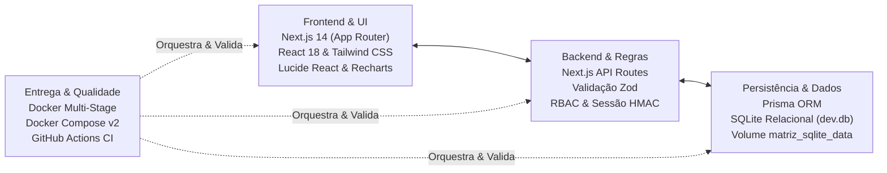

# Matriz — Plataforma de Gestão de Projetos e Acompanhamento de Equipas

[-orange.svg)](docs/release-notes-v1.1.0-rc.1.md)
[](.github/workflows/ci.yml)
[-2496ED.svg)](compose.yaml)
[](openapi.yaml)
[](README.md)

**Matriz** é uma aplicação web colaborativa desenvolvida para capacitar equipas a estruturar os seus projetos, gerir tarefas de forma ágil através de quadros Kanban interativos e acompanhar o progresso das entregas com métricas e indicadores de velocidade em tempo real.

O projeto foi construído utilizando o paradigma do **Desenvolvimento Assistido por Agentes de IA (*Agentic Approach*)**, integrando especificações rigorosas, validações defensivas ponta a ponta, controlo de acessos por papéis (RBAC), contentorização multi-stage com **Docker & Docker Compose** e esteiras de automação de qualidade via **GitHub Actions**.

---

## 1. Funcionalidades da Aplicação

| Módulo | Funcionalidades Principais |
|---|---|
| **Gestão de Projetos** | Criação, edição, listagem com paginação e pesquisa textual instantânea, acompanhamento de datas de início/fim e eliminação em cascata com diálogo de segurança. |
| **Quadro Kanban Interativo** | Visualização em 3 colunas (`TODO`, `IN_PROGRESS`, `DONE`) com movimentação fluida de cartões via drag-and-drop (`@hello-pangea/dnd`) e atualização otimista na interface. |
| **Múltiplos Responsáveis (N:M)** | Associação de múltiplos colaboradores à mesma tarefa com restrição relacional de unicidade (`@@unique([taskId, userId])`), impedindo duplicações acidentais. |
| **Comentários Colaborativos** | Registo cronológico de comentários em cada tarefa, com inferência estrita de autor e data no backend a partir da sessão ativa. |
| **Deteção Inteligente de Atrasos** | Destaque visual automático e badge contextual para qualquer tarefa cuja data limite tenha expirado em formato UTC (`isOverdue`). |
| **Dashboard Analítico** | Barra de progresso percentual ponderada, distribuição de tarefas por estado, listagem de tarefas críticas e gráfico de velocidade semanal (`recharts`). |
| **Autenticação & RBAC** | Sessões seguras baseadas em cookies HTTP-only assinados com HMAC-SHA256, senhas em hash `bcryptjs`, proteção contra IDOR e distinção estrita de perfis (**Gestor de Projeto** vs **Membro de Equipa**). |

---

## 2. Tecnologias Utilizadas



* **Frontend:** [Next.js 14.2](https://nextjs.org/) (App Router, Server & Client Components), [React 18](https://react.dev/), [Tailwind CSS 3.4](https://tailwindcss.com/), [Lucide React](https://lucide.dev/), [@hello-pangea/dnd](https://github.com/hello-pangea/dnd) e [Recharts 2.13](https://recharts.org/).
* **Backend:** Next.js Route Handlers (REST), [Zod 3.23](https://zod.dev/) para validação de esquemas e [bcryptjs](https://github.com/dcodeIO/bcrypt.js) para hashing criptográfico.
* **Base de Dados & ORM:** [Prisma ORM 5.21](https://www.prisma.io/) com **SQLite** relacional local (`prisma/dev.db`), garantindo portabilidade sem necessidade de servidores de base de dados externos.
* **Testes & QA:** Test Runner nativo do Node.js (`node:assert/strict`) e [Playwright 1.65](https://playwright.dev/) para testes End-to-End no navegador.
* **Contentorização & Orquestração:** [Docker](https://www.docker.com/) (imagem multi-stage baseada em Alpine Linux) e **Docker Compose v2** ([`compose.yaml`](compose.yaml)).
* **Integração Contínua (CI):** [GitHub Actions](.github/workflows/ci.yml) com análise estática de tipos, execução de testes automatizados, compilação de produção e smoke tests em contentores.

---

## 3. Pré-requisitos do Sistema

Para executar a aplicação no seu ambiente local, é necessário dispor de uma das seguintes configurações:

### Opção A: Execução via Docker Compose (Recomendada — Sem dependências locais de runtime)
* **Docker Engine:** Versão 24.0 ou superior instalada.
* **Docker Compose:** Versão 2.20 ou superior (incluído no Docker Desktop para Windows/macOS ou pacote `docker-compose-plugin` em Linux).

### Opção B: Execução Local Nativa
* **Node.js:** Versão 20 LTS (ou versões superiores compatíveis, como Node 22/26).
* **npm:** Versão 10 ou superior (instalado nativamente com o Node.js).
* **Git:** Para clonar o repositório.

---

## 4. Instruções de Instalação e Configuração

### Passo 1: Clonar o Repositório
```bash
git clone https://github.com/seu-utilizador/matriz.git
cd matriz
```

### Passo 2: Configurar Variáveis de Ambiente
Copie o ficheiro de exemplo para criar a sua configuração local:
```bash
# Em Linux / macOS:
cp .env.example .env

# Em Windows (PowerShell ou CMD):
copy .env.example .env
```

O ficheiro `.env` vem configurado por defeito com valores seguros para desenvolvimento:
* `DATABASE_URL="file:./dev.db"` (Base de dados SQLite embutida).
* `AUTH_SECRET="matriz-poc-super-secret-key-2026-auth"` (Chave para assinatura HMAC-SHA256 de cookies).
* `PORT=3000`.

### Passo 3: Instalação de Dependências (Para Execução Nativa)
```bash
npm install
```

### Passo 4: Migração da Base de Dados e Dados de Teste
Gera o esquema relacional SQLite e popula a base de dados com as contas e projetos de demonstração:
```bash
npx prisma migrate dev
npm run db:seed
```

---

## 5. Comandos de Execução da Aplicação

### 5.1 Execução com Docker Compose (Modo Recomendado)
A aplicação inclui orquestração com contentorização multi-stage e volume de dados persistente:

```bash
# 1. Construir a imagem e iniciar o serviço em segundo plano:
docker compose up -d --build
# ou via atalho npm: npm run docker:up

# 2. Verificar o estado e a saúde do contentor (healthcheck):
docker compose ps

# 3. Inspecionar os logs de arranque e pedidos em tempo real:
docker compose logs -f
# ou: npm run docker:logs

# 4. Parar a aplicação (preservando os dados no volume):
docker compose down
# ou: npm run docker:down
```

Após o arranque, abra o navegador em **[http://localhost:3000](http://localhost:3000)**.

### 5.2 Execução Local com Node.js

#### Modo de Desenvolvimento:
```bash
npm run dev
```
Inicia o servidor com hot-reload ativo em [http://localhost:3000](http://localhost:3000).

#### Modo de Produção:
```bash
npm run build
npm run start
```
Compila os artefactos otimizados para produção e arranca o servidor standalone na porta 3000.

---

## 6. Contas de Demonstração (PoC)

A aplicação inclui três contas pré-configuradas para demonstração e validação do Controlo de Acessos Baseado em Papéis (RBAC):

| Perfil de Acesso | Utilizador (Email) | Palavra-passe | Capacidades e Permissões |
|---|---|:---:|---|
| **Gestor de Projeto** | `luis.ferreira@matriz.local` | `password123` | **Acesso Total:** Criação/edição/eliminação de projetos, definição de prazos de entrega em tarefas e eliminação de cartões. |
| **Membro de Equipa** | `ana.silva@matriz.local` | `password123` | Movimentação de tarefas no Kanban, alteração de estado, inserção de comentários e desassociação das suas próprias tarefas. |
| **Membro de Equipa** | `carlos.ramos@matriz.local` | `password123` | Execução operacional de tarefas, colaboração em equipa e comentários. |

---

## 7. Instruções para Executar os Testes Automatizados

O projeto Matriz possui uma cobertura de testes rigorosa dividida em 11 suites independentes e reprodutíveis:

| Suite de Testes | Âmbito & Módulo Testado | Asserções | Comando de Execução |
|---|---|:---:|---|
| **End-to-End (Playwright)** | Fluxo completo do utilizador no browser (Login $\to$ Projeto $\to$ Criar Tarefa $\to$ Listagem) | 1 E2E | `npm run test:e2e` |
| **Validação Unitária de Título** | Casos válidos, higienização `trim()`, inválidos e BVA nos limiares 3 e 150 caracteres | 13 | `node tests/task-title-unit.test.ts` |
| **Integração de Tarefas & API** | Criação, consulta por ID, persistência SQLite e 5 cenários negativos com isolamento | 33 | `node tests/tasks-integration.test.ts` |
| **Segurança & Regressão IDOR** | Bloqueio de bypass via `X-User-Id`, mitigação de IDOR na desassociação e barreiras 403 | 21 | `node tests/security-idor.test.ts` |
| **Verificação Formal do MVP** | Validação, RBAC, anti-spoofing e persistência durável pós-reabertura (Casos 01 a 09) | 34 | `node tests/mvp-verification.test.ts` |
| **Integração Frontend & Métricas** | Agregação analítica, cálculo de percentagem, velocidade semanal e cliente API | 15 | `node tests/frontend-integration.test.ts` |
| **Comentários de Tarefas** | Threads cronológicas, inferência de autor por sessão e persistência relacional | 28 | `node tests/task-comments.test.ts` |
| **Múltiplos Responsáveis (N:M)** | Associação N:M, seleção elegível, remoção e restrição única `P2002` anti-duplicados | 12 | `node tests/task-assignees.test.ts` |
| **Gestão de Tarefas (CRUD)** | Schemas Zod, paginação, filtros combinados e cálculo em tempo de execução de `isOverdue` | 27 | `node tests/tasks-crud.test.ts` |
| **Gestão de Projetos (CRUD)** | Criação, edição, pesquisa textual por título, paginação e eliminação em cascata | 21 | `node tests/projects-crud.test.ts` |
| **Autenticação & RBAC** | Hashing bcrypt, emissão e validação de cookie HMAC-SHA256 e barreiras 403 Forbidden | 14 | `node tests/auth-rbac.test.ts` |
| **Observabilidade & Saúde** | Verificação ativa do SQLite (`SELECT 1`), medição de latência, uptime e logs JSON | 7 | `node tests/health-observability.test.ts` |

### Comandos Rápidos de Validação:

* **Para executar a suite formal principal:**
  ```bash
  node tests/mvp-verification.test.ts
  ```
* **Para executar o teste E2E com Playwright:**
  ```bash
  npm run test:e2e
  ```
* **Para verificar a tipagem estática do projeto:**
  ```bash
  npx tsc --noEmit
  ```
* **Para inspecionar visualmente a base de dados SQLite:**
  ```bash
  npx prisma studio
  ```
  *(Abre a interface web do Prisma Studio em `http://localhost:5555`).*

---

## 8. Documentação da API REST (OpenAPI 3.1)

A API REST do Matriz está documentada formalmente de acordo com o padrão **OpenAPI 3.1.0** no ficheiro [`openapi.yaml`](openapi.yaml).

O contrato especifica detalhadamente:
* Todos os endpoints de **Autenticação**, **Projetos**, **Tarefas** e **Métricas**.
* Esquemas de pedidos (*request bodies*), respostas de sucesso e respostas padronizadas de erro (`400 Bad Request`, `401 Unauthorized`, `403 Forbidden`, `404 Not Found`).
* Parâmetros de consulta (pesquisa, paginação, filtros de estado e prioridade).
* Mecanismos de segurança via cookie HTTP-only `matriz_session`.

Pode visualizar e interagir com este contrato importando o ficheiro [`openapi.yaml`](openapi.yaml) no [Swagger Editor](https://editor.swagger.io/) ou no [Postman](https://www.postman.com/).

---

## 9. Desafios Adicionais de Engenharia Implementados

Para além dos exercícios obrigatórios, o projeto incorpora três extensões opcionais de nível empresarial:

### 🛡️ Desafio A — Segurança Avançada na Pipeline
* **Software Composition Analysis (SCA):** Auditoria de vulnerabilidades em dependências npm via `npm audit` integrada no job de verificação estática.
* **Scan de Vulnerabilidades Docker com Trivy:** Integração da action [`aquasecurity/trivy-action`](https://github.com/aquasecurity/trivy-action) nas pipelines de CI e Release, analisando a imagem Alpine Linux contra a base de dados de CVEs conhecidas (`CRITICAL,HIGH`).

### 📊 Desafio B — Observabilidade & Disponibilidade
* **Endpoint Especializado de Saúde ([`/api/health`](src/app/api/health/route.ts)):** Realiza ping ativo à base de dados SQLite (`SELECT 1`), mede a latência em tempo real, monitoriza tempo de atividade (`uptime`) e consumo de memória RAM (`heapUsedMB`, `rssMB`).
* **Logger Estruturado em JSON ([`src/lib/logger.ts`](src/lib/logger.ts)):** Formatação canónica de logs para `stdout`/`stderr` com carimbo ISO UTC, nível de severidade e contexto serializável, permitindo ingestão automática em Datadog, ELK ou Docker Logs.
* **Healthchecks em Contentores:** Tanto o [`Dockerfile`](Dockerfile) como o [`compose.yaml`](compose.yaml) e os testes de fumo do CI validam ativamente o endpoint `/api/health`.

### 🚀 Desafio C — Publicação Automática no GitHub Container Registry (GHCR)
* **Workflow de Release ([`.github/workflows/release.yml`](.github/workflows/release.yml)):**
  - Disparado automaticamente na criação de tags semânticas de versão (`v*`) ou manualmente via `workflow_dispatch`.
  - Permissões mínimas de segurança (`contents: read`, `packages: write`).
  - Autenticação nativa e segura com `GITHUB_TOKEN` para publicação direta em `ghcr.io/luisafonsom/matriz-ai-course`.
  - Extração de tags SemVer (`1.1.0-rc.1`, `v1.1`, `latest`) com caching acelerado pelo GitHub Actions.

---

## 10. Mapa da Documentação Técnica Adicional (`/docs`)

O repositório disponibiliza um conjunto completo de especificações e relatórios técnicos:

* 🏛️ **[docs/architecture.md](docs/architecture.md):** Arquitetura do sistema, diagrama Mermaid expandido, módulos de domínio, persistência e camada operacional.
* 🚀 **[docs/deployment.md](docs/deployment.md):** Manual técnico de deployment com Docker, Docker Compose, volume persistente, healthchecks e troubleshooting.
* 📦 **[docs/release-notes-v1.1.0-rc.1.md](docs/release-notes-v1.1.0-rc.1.md):** Notas de lançamento detalhadas da Release Candidate `v1.1.0-rc.1`.
* 📝 **[CHANGELOG.md](CHANGELOG.md):** Histórico estruturado de alterações de acordo com o padrão *Keep a Changelog*.
* 🧪 **[docs/test-plan.md](docs/test-plan.md):** Plano de testes abrangendo cenários unitários, integração de API, testes E2E e testes de segurança.
* 🛡️ **[docs/quality-security-review.md](docs/quality-security-review.md):** Relatório de auditoria de segurança (revisão de código, análise estática e mitigação de vulnerabilidades IDOR).
* 📋 **[docs/requirements.md](docs/requirements.md):** Especificação integral dos requisitos funcionais (RF01 a RF12) e não funcionais (RNF01 a RNF06).
* 📖 **[docs/user-stories.md](docs/user-stories.md):** User Stories do MVP com critérios de aceitação em formato BDD (*Given/When/Then*).
* 🔒 **[docs/constraints.md](docs/constraints.md):** Restrições técnicas, pressupostos aprovados e decisões arquiteturais.
* 🗄️ **[docs/database.md](docs/database.md):** Dicionário de dados, modelo relacional e integridade referencial.
* 🤖 **[AGENTS.md](AGENTS.md):** Regras de conduta, diretrizes de persistência e comandos operacionais para agentes de IA de codificação.

---

## 11. Licença e Autoria

Este projeto foi desenvolvido como parte prática do curso de **Engenharia de Software com Inteligência Artificial / Agentic Software Development**.
Distribuído sob licença MIT. Consulte o ficheiro de licença para mais detalhes.
