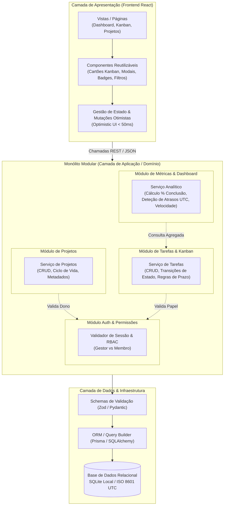

# Arquitetura do Sistema — Matriz

* **Projeto:** Matriz — Plataforma de Gestão de Projetos e Acompanhamento de Equipas
* **Contexto:** Ficha Prática 2 — Exercício 1 (Definição da Arquitetura)
* **Documentos de Referência:** [requirements.md](requirements.md) | [user-stories.md](user-stories.md) | [constraints.md](constraints.md)
* **Versão:** 1.0
* **Data:** 5 de Novembro de 2026
* **Estado:** Aprovado

---

## 1. Comparação de Soluções Arquiteturais no Âmbito do MVP

Para determinar a arquitetura ideal do PoC/MVP da plataforma Matriz, foram avaliados três paradigmas de arquitetura de software, tendo em conta as restrições de tempo, portabilidade local e desenvolvimento assistido por agentes de IA (*Agentic Approach*):

| Critério de Avaliação | Monólito Tradicional | Monólito Modular | Microservices |
|---|---|---|---|
| **Complexidade Operacional** | **Muito Baixa:** Executável único, um único processo e base de dados. | **Baixa:** Processo e base de dados unificados, sem overhead de rede. | **Muito Alta:** Múltiplos serviços, orquestração de containers, networking e observabilidade distribuída. |
| **Isolamento de Domínio e Acoplamento** | **Fraco:** Risco elevado de dependências circulares e código "esparguete". | **Forte:** Fronteiras estritas entre módulos com interfaces/contratos bem definidos. | **Muito Forte:** Isolamento a nível de processo e base de dados por serviço. |
| **Aptidão para IA Agêntica (*Agent-Friendly*)** | **Média:** Contexto único, mas alterações de um agente podem quebrar módulos alheios. | **Excelente:** Agentes podem focar-se em módulos específicos (ex: `tasks` ou `metrics`) com escopo delimitado e sem interferência cruzada. | **Média/Baixa:** Excesso de repositórios, contratos distribuídos e sincronização complexa para um PoC. |
| **Velocidade de Implementação (Time-to-MVP)** | **Rápida** | **Rápida e Sustentável** | **Muito Lenta:** Overhead de configuração excessivo. |
| **Portabilidade Local e Zero-Setup (RNF05)** | **Total:** Corre diretamente na máquina de desenvolvimento. | **Total:** Ficheiro local SQLite e runtime unificado. | **Deficiente:** Exige Docker Compose pesado ou scripts multi-processo. |

---

## 2. Seleção e Justificação da Arquitetura Escolhida

### Opção Selecionada: **Monólito Modular (*Modular Monolith*)**

### Justificação:
1. **Equilíbrio Óptimo entre Simplicidade e Estrutura:**  
   O Monólito Modular permite executar toda a aplicação num único processo local (atendendo ao RNF05 de zero-setup externo e suporte a SQLite), sem a sobrecarga de orquestração distribuída típica dos microserviços.
2. **Alta Coesão e Baixo Acoplamento:**  
   Ao organizar o código em módulos encapsulados por domínio de negócio (`projects`, `tasks`, `metrics`, `auth`), garante-se que a lógica de cálculo de métricas ou as transições de estado do Kanban não se misturem diretamente com a camada de persistência genérica.
3. **Maximização da Eficiência Agêntica (*Agentic-Friendly*):**  
   Os agentes de codificação operam melhor quando dispõem de fronteiras modulares delimitadas. Um agente encarregado de implementar o gráfico de velocidade semanal precisa apenas de inspecionar o contrato do módulo `metrics` e ler os tipos do módulo `tasks`, reduzindo o consumo de tokens de contexto e eliminando alucinações de dependências.
4. **Evolutividade sem Débito Técnico:**  
   Se no futuro a plataforma necessitar de extrair um serviço autónomo (ex: motor analítico ou notificações push), as fronteiras do Monólito Modular já se encontram limpas e formalizadas, evitando refatorações destrutivas.

---

## 3. Decomposição de Componentes e Responsabilidades

A aplicação é dividida em três camadas estruturadas: **Camada de Apresentação (Frontend UI)**, **Camada de Domínio Modular (Core Services & Handlers)** e **Camada de Infraestrutura e Dados**.

### 3.1 Responsabilidade dos Módulos

#### A. Módulo `Auth & Permissões`
* **Responsabilidade:** Gerir a identidade do utilizador em sessão e aplicar o Controlo de Acesso Baseado em Papéis (**RBAC**).
* **Regras Específicas:** Validar no backend se a operação de alteração de datas limite ou eliminação de tarefas pertence a um utilizador com perfil `PROJECT_MANAGER`.

#### B. Módulo `Projetos`
* **Responsabilidade:** Gerir o ciclo de vida dos projetos (`ACTIVE`, `COMPLETED`, `ON_HOLD`).
* **Regras Específicas:** Validação de datas de início e fim, título obrigatório (3-100 caracteres) e relacionamento 1:N com tarefas.

#### C. Módulo `Tarefas & Kanban`
* **Responsabilidade:** Orquestrar o ciclo de vida e transições de estado das tarefas (`TODO` -> `IN_PROGRESS` -> `DONE`).
* **Regras Específicas:** Validação de prioridades (`LOW`, `MEDIUM`, `HIGH`), atribuição de membros, persistência de `updated_at`, bloqueio de alteração de `due_date` para membros não gestores e computação em tempo de execução do atributo virtual `isOverdue` (`now > due_date && status != DONE`).

#### D. Módulo `Métricas & Dashboard`
* **Responsabilidade:** Agregar dados analíticos em tempo real de forma isolada da lógica transacional.
* **Regras Específicas:** 
  * Cálculo da percentagem de progresso: `total > 0 ? (concluídas / total) * 100 : 0`.
  * Deteção de tarefas atrasadas: filtro dinâmico de tarefas não concluídas cuja `due_date` expirou às 23:59:59 UTC (sem persistência física de flags temporais na base de dados).
  * Agregação de velocidade: contagem de tarefas concluídas por dia nos últimos 7 dias.

#### E. Camada de Infraestrutura e Dados
* **Responsabilidade:** Validação estrita de contratos de entrada/saída (Zod/Pydantic), mapeamento objeto-relacional (ORM) e garantia de integridade relacional (`ON DELETE SET NULL` para membros removidos).

---

## 4. Padrões de Comunicação e Fluxo de Dados

1. **Requisição Segura:** O Frontend envia comandos via HTTP/REST utilizando payloads JSON tipados.
2. **Validação Defensiva:** O endpoint aciona o schema de validação antes de qualquer processamento; payloads com campos extras ou formatos inválidos são rejeitados com HTTP 400.
3. **Verificação de Permissão no Backend:** O serviço invoca o validador de RBAC para assegurar que o utilizador ativo tem legitimidade para a ação solicitada.
4. **Mutação Otimista na Interface:** No cliente, o cartão Kanban ou o contador é atualizado em < 50ms na interface gráfica. Caso a API retorne erro (ex: 403 Forbidden ou 409 Conflict), o frontend reverte a alteração e alerta o utilizador.
5. **Persistência UTC:** Todas as operações com datas garantem a gravação em formato ISO 8601 UTC.

---

## 5. Diretrizes para o Paradigma Agêntico (*Agentic Guidelines*)

Para manter a consistência da arquitetura durante o desenvolvimento iterativo com agentes:
* **Estrutura de Diretórios Espelhada:** Cada módulo funcional possui a sua pasta contendo: tipos/schemas (`types.ts`), serviço de domínio (`service.ts`), rotas da API (`route.ts`) e componentes visuais associados (`components/`).
* **Sem Imports Circulares:** Módulos não acedem diretamente às tabelas ou estados internos uns dos outros; o acesso a dados de outro domínio é feito através de serviços públicos do módulo ou consultas agregadas explícitas.
* **Contratos Declarativos:** Quaisquer alterações aos dados devem ser precedidas da atualização dos schemas e tipos correspondentes.

---

## 6. Stack Tecnológica Confirmada (Ficha 3)

| Camada | Tecnologia Adotada |
|---|---|
| **Runtime & Framework** | **Next.js 14+ (App Router, TypeScript, React Server/Client Components)** |
| **Estilização & UI** | **Tailwind CSS + Lucide React** |
| **Camada de Dados & ORM** | **Prisma ORM com SQLite (`prisma/dev.db`)** |
| **Validação de Schemas** | **Zod** |
| **Interatividade Kanban** | **`@hello-pangea/dnd`** |
| **Gráficos e Analítica** | **Recharts** |
| **Autenticação Local** | **Mock Switcher via cabeçalho `X-User-Id` com RBAC ativo no backend** |
