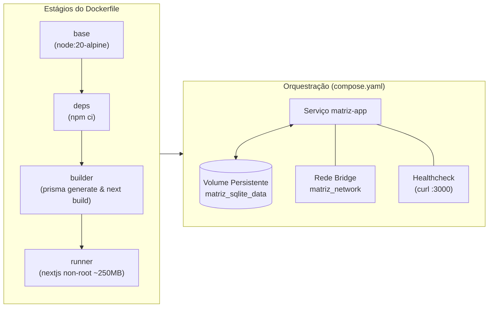

# Arquitetura do Sistema — Matriz

* **Projeto:** Matriz — Plataforma de Gestão de Projetos e Acompanhamento de Equipas
* **Contexto:** Ficha Prática 5 — Exercício 5: Documentação Técnica e Arquitetural
* **Documentos de Referência:** [`README.md`](../README.md) | [`docs/requirements.md`](requirements.md) | [`docs/user-stories.md`](user-stories.md) | [`docs/constraints.md`](constraints.md) | [`docs/database.md`](database.md) | [`docs/deployment.md`](deployment.md) | [`openapi.yaml`](../openapi.yaml) | [`compose.yaml`](../compose.yaml)
* **Versão:** `1.1.0-rc.1`
* **Data:** 12 de Novembro de 2026
* **Estado:** Aprovado para Release Candidate

---

## 1. Comparação de Soluções Arquiteturais no Âmbito do MVP

Para determinar a arquitetura ideal do PoC/MVP da plataforma Matriz, foram avaliados três paradigmas de arquitetura de software, tendo em conta as restrições de tempo, portabilidade local e desenvolvimento assistido por agentes de IA (*Agentic Approach*):

| Critério de Avaliação | Monólito Tradicional | Monólito Modular | Microservices |
|---|---|---|---|
| **Complexidade Operacional** | **Muito Baixa:** Executável único, um único processo e base de dados. | **Baixa:** Processo e base de dados unificados, sem overhead de rede. | **Muito Alta:** Múltiplos serviços, orquestração de containers, networking e observabilidade distribuída. |
| **Isolamento de Domínio e Acoplamento** | **Fraco:** Risco elevado de dependências circulares e código "esparguete". | **Forte:** Fronteiras estritas entre módulos com interfaces/contratos bem definidos. | **Muito Forte:** Isolamento a nível de processo e base de dados por serviço. |
| **Aptidão para IA Agêntica (*Agent-Friendly*)** | **Média:** Contexto único, mas alterações de um agente podem quebrar módulos alheios. | **Excelente:** Agentes podem focar-se em módulos específicos (ex: `tasks` ou `metrics`) com escopo delimitado e sem interferência cruzada. | **Média/Baixa:** Excesso de repositórios, contratos distribuídos e sincronização complexa para um PoC. |
| **Velocidade de Implementação (Time-to-MVP)** | **Rápida** | **Rápida e Sustentável** | **Muito Lenta:** Overhead de configuração excessivo. |
| **Portabilidade Local e Zero-Setup (RNF05)** | **Total:** Corre diretamente na máquina de desenvolvimento. | **Total:** Ficheiro local SQLite e runtime unificado. | **Deficiente:** Exige Docker Compose pesado ou scripts multi-processo. |

---

## 2. Seleção e Justificação da Arquitetura Escolhida

### Opção Selecionada: **Monólito Modular (*Modular Monolith*)**

### Justificação:
1. **Equilíbrio Óptimo entre Simplicidade e Estrutura:**  
   O Monólito Modular permite executar toda a aplicação num único processo local (atendendo ao RNF05 de zero-setup externo e suporte a SQLite), sem a sobrecarga de orquestração distribuída típica dos microserviços.
2. **Alta Coesão e Baixo Acoplamento:**  
   Ao organizar o código em módulos encapsulados por domínio de negócio (`projects`, `tasks`, `metrics`, `auth`), garante-se que a lógica de cálculo de métricas ou as transições de estado do Kanban não se misturem diretamente com a camada de persistência genérica.
3. **Maximização da Eficiência Agêntica (*Agentic-Friendly*):**  
   Os agentes de codificação operam melhor quando dispõem de fronteiras modulares delimitadas. Um agente encarregado de implementar o gráfico de velocidade semanal precisa apenas de inspecionar o contrato do módulo `metrics` e ler os tipos do módulo `tasks`, reduzindo o consumo de tokens de contexto e eliminando alucinações de dependências.
4. **Evolutividade sem Débito Técnico:**  
   Se no futuro a plataforma necessitar de extrair um serviço autónomo (ex: motor analítico ou notificações push), as fronteiras do Monólito Modular já se encontram limpas e formalizadas, evitando refatorações destrutivas.

---

## 3. Decomposição de Componentes, Camadas e Operações

A arquitetura do **Matriz** organiza-se em quatro níveis perfeitamente articulados: **Camada de Apresentação (Frontend React)**, **Camada de Domínio e Aplicação (Monólito Modular)**, **Camada de Dados & Persistência Relacional**, e **Camada de Operações & Entrega Contínua (Docker Compose & CI/CD)**.

```mermaid
flowchart TB
    subgraph UI ["1. Camada de Apresentação (Frontend Next.js / React 18)"]
        direction TB
        Views["Vistas & Páginas<br/>(Dashboard KPIs, Kanban Interativo, Gestão de Projetos)"]
        Components["Componentes Reutilizáveis<br/>(Cartões Kanban, Modais de Tarefas, Badges de Atraso, Filtros)"]
        State["Gestão de Estado & UI Otimista<br/>(Mutações instantâneas & feedback visual imediato)"]
        Views --> Components
        Components --> State
    end

    subgraph Core ["2. Monólito Modular (Camada de Domínio & Aplicação)"]
        direction TB
        subgraph AuthMod ["Módulo Auth & Permissões"]
            AuthService["Validador de Sessão HMAC-SHA256 & RBAC<br/>(PROJECT_MANAGER vs TEAM_MEMBER)"]
        end
        subgraph ProjMod ["Módulo de Projetos"]
            ProjService["Serviço de Projetos<br/>(CRUD, Ciclo de Vida, Metadados, Eliminação em Cascata)"]
        end
        subgraph TaskMod ["Módulo de Tarefas & Kanban"]
            TaskService["Serviço de Tarefas<br/>(CRUD, Transições de Estado, Atribuição N:M, Comentários, Anti-IDOR)"]
        end
        subgraph MetricMod ["Módulo de Métricas & Dashboard"]
            MetricService["Serviço Analítico em Tempo Real<br/>(Cálculo % Conclusão, Deteção de Atrasos UTC, Velocidade 7 Dias)"]
        end
    end

    subgraph Infra ["3. Camada de Dados & Persistência"]
        direction TB
        Validation["Schemas de Validação Defensiva (Zod)"]
        ORM["Mapeamento Objeto-Relacional (Prisma ORM Client)"]
        DB[(Base de Dados Relacional SQLite<br/>/app/prisma/dev.db / Datas em ISO 8601 UTC)]
        Volume[("Volume Persistente Docker<br/>matriz_sqlite_data")]
        DB <--> Volume
    end

    subgraph Ops ["4. Camada de Operações, Containerização & CI/CD"]
        direction TB
        DockerComp["Docker Compose (compose.yaml)<br/>Serviço matriz-app (:3000) & Rede matriz_network"]
        Health["Healthcheck Periódico<br/>(curl -f http://localhost:3000/)"]
        CI["Pipeline GitHub Actions (.github/workflows/ci.yml)<br/>typecheck -> test -> build -> docker-smoke-test"]
        DockerComp --> Health
        CI -.->|Valida e Constrói| DockerComp
    end

    UI -->|Chamadas HTTP/REST Tipadas (Cookie matriz_session)| Core
    Core --> Validation
    Validation --> ORM
    ORM --> DB

    MetricMod -.->|Consulta Agregada| TaskMod
    ProjMod -.->|Validação de Dono e Permissões| AuthMod
    TaskMod -.->|Validação RBAC e Sessão| AuthMod
    DockerComp --- Core
```

---

### 3.1 Responsabilidade dos Módulos de Domínio

#### A. Módulo `Auth & Permissões`
* **Responsabilidade:** Gerir a identidade do utilizador em sessão, cifrar e verificar credenciais com `bcryptjs` e aplicar o Controlo de Acesso Baseado em Papéis (**RBAC**).
* **Segurança e Higienização:**
  * Emissão de cookies HTTP-only `matriz_session` com assinatura criptográfica HMAC-SHA256.
  * Rejeição categórica de bypass de identidade por cabeçalho `X-User-Id` (SEC-01).
  * Inferência de identidade no backend: o dono do projeto (`managerId`) e o autor do comentário (`authorId`) são sempre extraídos do token validado, prevenindo spoofing de parâmetros.

#### B. Módulo `Projetos`
* **Responsabilidade:** Gerir o ciclo de vida dos projetos (`ACTIVE`, `COMPLETED`, `ON_HOLD`).
* **Regras Específicas:** Validação de datas, título obrigatório (3-100 caracteres), descrição (até 1000 caracteres), paginação, pesquisa textual e eliminação em cascata de tarefas dependentes.

#### C. Módulo `Tarefas & Kanban`
* **Responsabilidade:** Orquestrar o ciclo de vida e transições de estado das tarefas (`TODO` $\to$ `IN_PROGRESS` $\to$ `DONE`).
* **Regras Específicas:**
  * Higienização defensiva com Zod (`trim()`, mínimo 3 e máximo 150 caracteres para o título).
  * Atribuição flexível N:M com restrição relacional de unicidade `@@unique([taskId, userId])` impedindo duplicados.
  * Proteção IDOR (SEC-02): Membros de Equipa apenas podem desassociar tarefas atribuídas a si próprios.
  * Computação dinâmica do atributo virtual `isOverdue` (`now > dueDate && status != DONE`).

#### D. Módulo `Métricas & Dashboard`
* **Responsabilidade:** Agregar dados analíticos em tempo real de forma isolada da lógica transacional.
* **Regras Específicas:**
  * Cálculo de progresso percentual: `total > 0 ? (concluídas / total) * 100 : 0`.
  * Filtro de tarefas críticas e atrasadas com base em timestamps UTC.
  * Agregação da velocidade de entrega (tarefas concluídas por dia nos últimos 7 dias).

---

## 4. Padrões de Comunicação e Fluxo de Dados

1. **Requisição Segura:** O Frontend envia comandos via HTTP/REST utilizando payloads JSON tipados acompanhados do cookie HTTP-only `matriz_session`.
2. **Validação Defensiva com Zod:** O endpoint aciona o schema de validação antes de qualquer processamento; payloads com dados mal formatados, strings vazias ou tamanhos inválidos são rejeitados com HTTP 400 Bad Request.
3. **Verificação de Permissão no Backend (RBAC):** O serviço invoca o validador de autorização assegurando que apenas `PROJECT_MANAGER` pode alterar prazos ou eliminar entidades.
4. **Mutação Otimista na Interface:** No cliente React, o cartão Kanban é movido instantaneamente (< 50ms). Caso a API responda com erro (ex: 403 Forbidden), a interface reverte automaticamente a posição do cartão e exibe notificação de erro.
5. **Persistência UTC:** Todas as operações com datas garantem a gravação em formato ISO 8601 UTC no SQLite.

---

## 5. Arquitetura de Containerização e Orquestração

Para assegurar paridade estrita entre o ambiente de desenvolvimento, a pipeline de CI e a execução em produção:



* **Dockerfile Multi-Stage:** Compilação desacoplada em estágios para gerar uma imagem de execução minimalista, sem ferramentas de compilação ou ficheiros desnecessários.
* **Utilizador Sem Privilégios (*Non-Root*):** Execução atribuída ao utilizador de sistema `nextjs:nodejs` (UID 1001).
* **Persistência de Dados Relacionais:** O volume nomeado `matriz_sqlite_data` garante que o ficheiro `dev.db` sobrevive à recriação e paragem de contentores (`docker compose down`).
* **Verificação de Saúde Automatizada:** Healthcheck integrado no contentor a testar a porta 3000 periodicamente.

---

## 6. Documentação Formal da API REST (OpenAPI 3.1)

A API do Matriz está integralmente especificada no contrato formal [`openapi.yaml`](../openapi.yaml), seguindo a especificação **OpenAPI 3.1.0**.

### Principais Recursos Documentados:
* **Autenticação:** `POST /auth/login`, `POST /auth/logout`, `GET /auth/me`.
* **Projetos:** `GET /projects`, `POST /projects`, `GET /projects/{id}`, `PUT /projects/{id}`, `DELETE /projects/{id}`, `GET /projects/{id}/tasks`, `POST /projects/{id}/tasks`.
* **Tarefas & Kanban:** `GET /tasks/{id}`, `PUT /tasks/{id}`, `DELETE /tasks/{id}`, `PATCH /tasks/{id}/status`, `POST /tasks/{id}/assignees`, `DELETE /tasks/{id}/assignees/{userId}`, `POST /tasks/{id}/comments`.
* **Métricas:** `GET /metrics/dashboard`, `GET /metrics/velocity`.

O ficheiro pode ser visualizado ou consumido diretamente em ferramentas compatíveis (Swagger UI, Redoc, Postman).

---

## 7. Stack Tecnológica Atualizada (v1.1.0-rc.1)

| Camada / Função | Tecnologia Adotada | Finalidade no Projeto |
|---|---|---|
| **Runtime & Framework** | **Next.js 14.2.20 (App Router, Standalone)** | Framework fullstack React com rotas de API e Server Components. |
| **Linguagem & Tipagem** | **TypeScript 5.6** | Tipagem estática defensiva ponta a ponta. |
| **Interface & Estilos** | **Tailwind CSS 3.4 + Lucide React** | Design responsivo, moderno e sistema de design coeso. |
| **Camada de Dados & ORM** | **Prisma ORM 5.21 com SQLite (`dev.db`)** | Modelagem relacional, migrações e seed idempotente. |
| **Validação de Schemas** | **Zod 3.23** | Validação em runtime de todos os payloads de entrada e saída. |
| **Interatividade Drag-and-Drop** | **`@hello-pangea/dnd` 17.0** | Movimentação fluida de cartões no quadro Kanban. |
| **Visualização de Dados** | **Recharts 2.13** | Gráficos de velocidade semanal e KPIs do Dashboard. |
| **Segurança e Sessão** | **`bcryptjs` + HMAC-SHA256 em Cookies HTTP-Only** | Hashing seguro de senhas e tokens de sessão invioláveis. |
| **Testes Unitários e Integração**| **Node.js Test Runner (`node:assert/strict`)** | Execução ultrarrápida nativa de suites de backend e lógica. |
| **Testes End-to-End** | **Playwright 1.65** | Automação e asserções visuais no browser headless. |
| **Contentorização** | **Docker (Node 20 Alpine) Multi-Stage** | Empacotamento minimalista e reprodutível. |
| **Orquestração Local** | **Docker Compose v2 (`compose.yaml`)** | Orquestração com rede dedicada e volume persistente. |
| **Integração Contínua (CI)** | **GitHub Actions (`ci.yml`)** | Automação sequencial de typecheck, testes, build e smoke test. |
