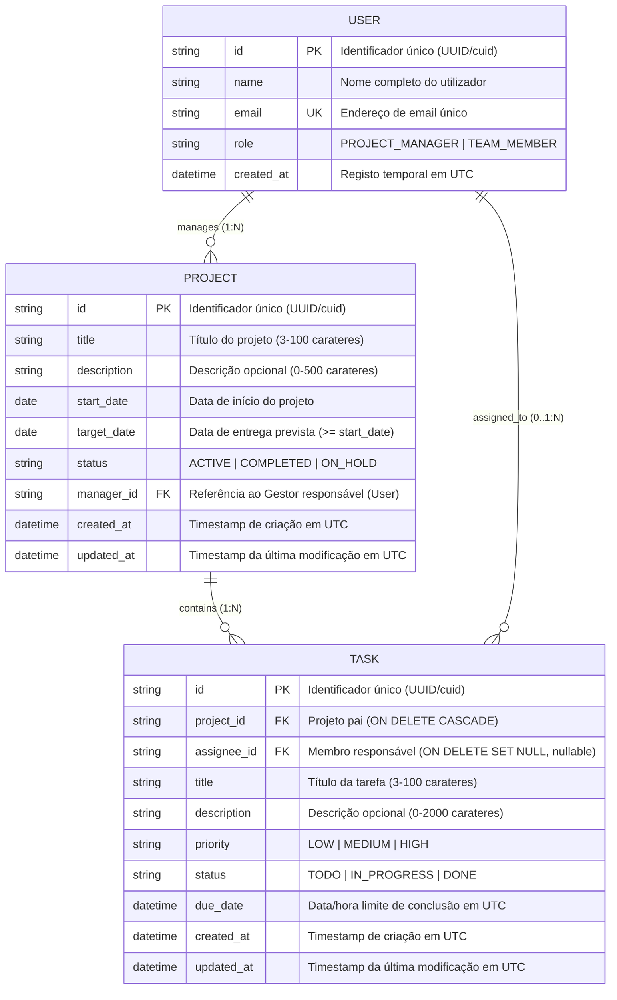

# Modelação de Dados e Diagrama ER — Matriz

* **Projeto:** Matriz — Plataforma de Gestão de Projetos e Acompanhamento de Equipas
* **Contexto:** Ficha Prática 2 — Exercício 2 (Modelação de Dados e Diagrama ER)
* **Documentos de Referência:** [requirements.md](requirements.md) | [user-stories.md](user-stories.md) | [constraints.md](constraints.md) | [architecture.md](architecture.md)
* **Versão:** 1.0
* **Data:** 5 de Novembro de 2026
* **Estado:** Aprovado

---

## 1. Visão Geral do Modelo de Dados

O modelo de dados da plataforma **Matriz** foi projetado para suportar com eficácia os fluxos operacionais do MVP: organização hierárquica por projetos, ciclo de vida de tarefas em quadro Kanban, controlo de acessos por papel (RBAC) e agregação de métricas de progresso e velocidade.

A persistência adota uma **base de dados relacional** (SQLite para execução local e zero-setup, compatível com migração para PostgreSQL via ORM), garantindo integridade referencial estrita, tipagem forte e rastreabilidade temporal em **UTC (ISO 8601)**.

---

## 2. Diagrama Entidade-Relacionamento (Mermaid)

---

## 3. Dicionário de Dados e Atributos

### 3.1 Entidade `USER` (Utilizadores e Perfis)
Armazena a identidade dos utilizadores e o respetivo papel para controlo de permissões (RBAC).

| Campo | Tipo | Nulo? | Chave | Descrição e Regras |
|---|---|:---:|:---:|---|
| `id` | `VARCHAR(36)` | Não | **PK** | Identificador único (UUID v4 ou CUID). |
| `name` | `VARCHAR(100)` | Não | | Nome visível na interface e cartões de tarefas. |
| `email` | `VARCHAR(255)` | Não | **UK** | Email de login e identificador único na organização. |
| `role` | `VARCHAR(20)` | Não | | Papel operacional: `PROJECT_MANAGER` ou `TEAM_MEMBER`. |
| `created_at` | `DATETIME` | Não | | Registo de criação em formato UTC. |

---

### 3.2 Entidade `PROJECT` (Projetos)
Contentor principal para agregação e contextualização das tarefas e objetivos da equipa.

| Campo | Tipo | Nulo? | Chave | Descrição e Regras |
|---|---|:---:|:---:|---|
| `id` | `VARCHAR(36)` | Não | **PK** | Identificador único do projeto. |
| `title` | `VARCHAR(100)` | Não | | Título obrigatório (3 a 100 caracteres). |
| `description` | `VARCHAR(500)` | Sim | | Descrição sucinta do âmbito e metas (0 a 500 caracteres). |
| `start_date` | `DATE` | Não | | Data de início planeada. |
| `target_date` | `DATE` | Não | | Prazo limite global do projeto (`target_date >= start_date`). |
| `status` | `VARCHAR(20)` | Não | | Estado atual: `ACTIVE`, `COMPLETED` ou `ON_HOLD`. Valor por omissão: `ACTIVE`. |
| `manager_id` | `VARCHAR(36)` | Não | **FK** | Referência ao utilizador gestor (`USER.id`). Restrito a perfis `PROJECT_MANAGER`. |
| `created_at` | `DATETIME` | Não | | Data/hora de registo em UTC. |
| `updated_at` | `DATETIME` | Não | | Atualizado a cada mutação de dados do projeto. |

---

### 3.3 Entidade `TASK` (Tarefas e Fluxo Kanban)
Unidade elementar de trabalho executável associada a um projeto.

| Campo | Tipo | Nulo? | Chave | Descrição e Regras |
|---|---|:---:|:---:|---|
| `id` | `VARCHAR(36)` | Não | **PK** | Identificador único da tarefa. |
| `project_id` | `VARCHAR(36)` | Não | **FK** | Projeto ao qual a tarefa pertence (`PROJECT.id`). |
| `assignee_id` | `VARCHAR(36)` | Sim | **FK** | Membro responsável (`USER.id`). `NULL` indica tarefa não atribuída (*Unassigned*). |
| `title` | `VARCHAR(100)` | Não | | Título claro e objetivo (3 a 100 caracteres). |
| `description` | `TEXT` | Sim | | Detalhes e especificações da atividade (0 a 2000 caracteres). |
| `priority` | `VARCHAR(10)` | Não | | Nível de urgência: `LOW`, `MEDIUM` ou `HIGH`. Valor por omissão: `MEDIUM`. |
| `status` | `VARCHAR(20)` | Não | | Coluna do Kanban: `TODO`, `IN_PROGRESS` ou `DONE`. Valor por omissão: `TODO`. |
| `due_date` | `DATETIME` | Não | | Data limite de entrega. Expira às 23:59:59 UTC do dia estipulado. |
| `created_at` | `DATETIME` | Não | | Data/hora de criação em UTC. |
| `updated_at` | `DATETIME` | Não | | Renovado a cada alteração de estado, atribuição ou conteúdo. |

> **Nota de Arquitetura (Campo Virtual vs. Persistido):** O atributo `isOverdue` presente nas respostas da API (`openapi.yaml` e Dashboard) é estritamente um **campo virtual computado em tempo de execução** na camada de serviço (`TaskService`), calculado a partir da fórmula $\text{NOW(UTC)} > \text{due\_date} \land \text{status} \ne \text{'DONE'}$. Não é armazenado como coluna física na tabela `TASK` para evitar inconsistências e necessidade de rotinas assíncronas (*cron jobs*) de atualização.

---

## 4. Cardinalidades e Integridade Referencial

### 4.1 Relacionamentos

1. **`USER` (1) — (0..N) `PROJECT` [Gerir]:**
   * Um Gestor de Projeto pode criar e gerir zero ou múltiplos projetos.
   * Cada projeto tem obrigatoriamente um único Gestor responsável (`manager_id NOT NULL`).
   * **Integridade:** `ON DELETE RESTRICT` — Não é permitido apagar um gestor enquanto este tiver projetos ativos associados.

2. **`PROJECT` (1) — (0..N) `TASK` [Conter]:**
   * Um projeto contém zero ou múltiplas tarefas.
   * Cada tarefa pertence a um e apenas um projeto (`project_id NOT NULL`).
   * **Integridade:** `ON DELETE CASCADE` — A eliminação de um projeto remove todas as tarefas filhas associadas.

3. **`USER` (0..1) — (0..N) `TASK` [Atribuir]:**
   * Um utilizador pode ser responsável por zero ou múltiplas tarefas.
   * Uma tarefa pode estar atribuída a um membro ou encontrar-se não atribuída (`assignee_id` anulável).
   * **Integridade (Caso-Limite EC03):** `ON DELETE SET NULL` — Se um membro for desativado/removido, as suas tarefas não são eliminadas; o campo `assignee_id` passa a `NULL` e a tarefa torna-se "Não Atribuída".

---

## 5. Regras de Negócio e Validações Embutidas no Modelo

1. **Validação Temporal de Prazos (EC02):**
   * A data limite da tarefa não pode ser anterior à data de início do projeto pai:  
     $$\text{TASK.due\_date} \ge \text{PROJECT.start\_date}$$
2. **Definição Estrita de Atraso (RF11 / US04):**
   * Uma tarefa é considerada em atraso no sistema se e só se:  
     $$\text{TASK.status} \ne \text{'DONE'} \quad \land \quad \text{NOW(UTC)} > \text{TASK.due\_date (23:59:59 UTC)}$$
3. **Imutabilidade de Prazo por Membros de Equipa (US02 - Cenário 2.3):**
   * O campo `TASK.due_date` só pode ser alterado via API por utilizadores com perfil `PROJECT_MANAGER`.
4. **Cálculo Seguro de Percentagem de Conclusão (EC01):**
   * Para evitar exceções de divisão por zero quando um projeto não possui tarefas:  
     $$\text{Progresso(\%)} = \begin{cases} 0\% & \text{se } \text{Total Tarefas} = 0 \\ \left(\frac{\text{Tarefas no estado DONE}}{\text{Total Tarefas}}\right) \times 100 & \text{se } \text{Total Tarefas} > 0 \end{cases}$$

---

## 6. Pressupostos e Pontos de Decisão por Confirmar

| # | Ponto em Análise | Pressuposto Adotado no Modelo | Alternativa Futura (Pós-MVP) |
|---|---|---|---|
| **P1** | **Associação Membro-Projeto (*Project Membership*)** | **Organização Aberta:** Qualquer utilizador registado na organização pode ser atribuído a qualquer tarefa de qualquer projeto. Dispensa tabela associativa `PROJECT_USER` no MVP. | Criar tabela N:M `PROJECT_MEMBER` com permissões granulares por projeto caso seja exigido isolamento restrito entre equipas. |
| **P2** | **Histórico de Transições do Kanban** | As transições são refletidas em tempo real atualizando `status` e `updated_at` na tabela `TASK`. | Criar tabela `TASK_AUDIT_LOG` (`task_id`, `from_status`, `to_status`, `changed_by`, `timestamp`) caso se pretenda auditoria formal de conformidade. |
| **P3** | **Soft Delete vs. Hard Delete** | Para o PoC, utiliza-se eliminação física (*Hard Delete*) com salvaguarda `SET NULL` em chaves estrangeiras. | Adicionar coluna `deleted_at (DATETIME, nullable)` caso seja necessário restauro de projetos/tarefas apagados por engano. |
