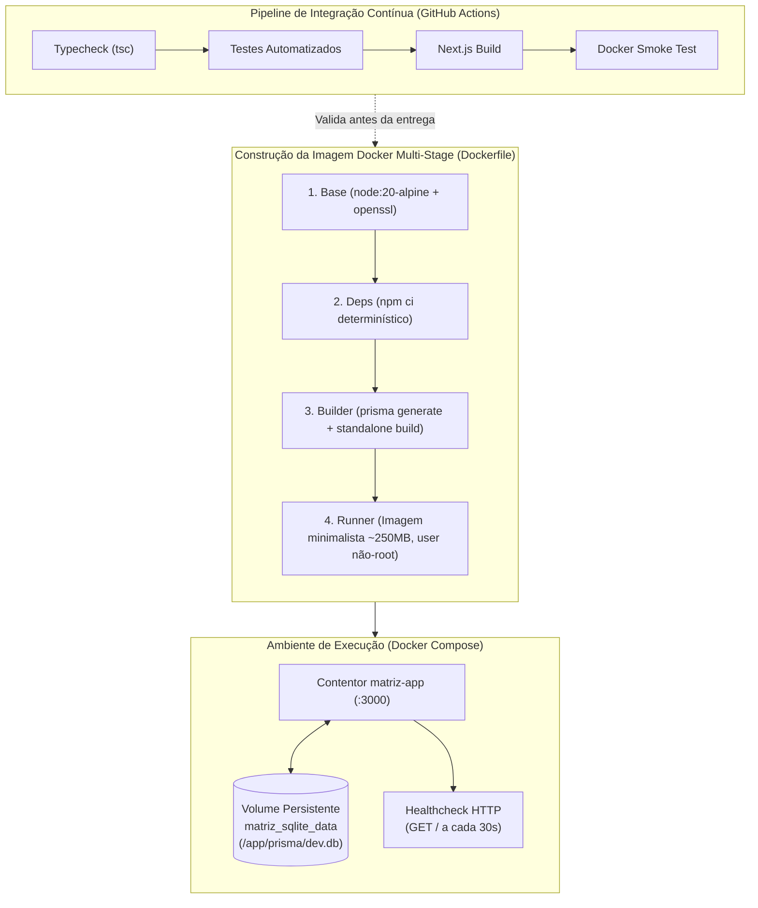

# Manual Técnico de Deployment e Operações — Matriz

* **Projeto:** Matriz — Plataforma de Gestão de Projetos e Acompanhamento de Equipas
* **Contexto:** Ficha Prática Laboratorial 05 — Automação, Contentorização e CI/CD
* **Stack de Entrega:** Docker (Multi-Stage Build), Docker Compose, GitHub Actions, SQLite Persistente
* **Documentos de Referência:** [`AGENTS.md`](../AGENTS.md) | [`README.md`](../README.md) | [`docs/architecture.md`](architecture.md) | [`Dockerfile`](../Dockerfile) | [`docker-compose.yml`](../docker-compose.yml)
* **Data:** 12 de Novembro de 2026
* **Versão:** 1.0 — Guia de Operações e Deployment

---

## 1. Visão Geral da Arquitetura de Entrega

A estratégia de entrega e execução da plataforma **Matriz** foi concebida para garantir **100% de reprodutibilidade** em qualquer ambiente (Windows, macOS, Linux, runners de CI/CD), eliminando o clássico problema *"funciona na minha máquina"*.



---

## 2. Contentorização com Docker (Multi-Stage Build)

O [`Dockerfile`](file:///C:/Users/LuisFerreira/Personal_projects/AI_PTH_Course/matriz/Dockerfile) implementa o padrão multi-stage otimizado para Next.js 14 Standalone:

1. **Estágio `base`:** Imagem oficial `node:20-alpine` com os pacotes de sistema `libc6-compat` e `openssl` (necessários para os binários nativos do Prisma ORM no Alpine Linux).
2. **Estágio `deps`:** Instalação limpa de dependências com `npm ci --fetch-retries 5`.
3. **Estágio `builder`:**
   * Executa `npx prisma generate` para compilar os tipos do Prisma Client.
   * Compila o script de seed para JavaScript (`prisma/dist/seed.js`) compatível com qualquer versão do Node.js.
   * Compila o frontend e rotas de API com `npm run build` gerando a pasta `.next/standalone`.
4. **Estágio `runner`:**
   * Utilizador de sistema com privilégios reduzidos (`nextjs:nodejs` UID/GID 1001).
   * Cópia exclusiva dos artefactos necessários à execução (`.next/standalone`, `.next/static`, `public`, `prisma` e `node_modules`).
   * Configuração de `HEALTHCHECK` periódico validando resposta HTTP 200 na porta 3000.
   * Ponto de entrada gerido pelo script [`docker-entrypoint.sh`](file:///C:/Users/LuisFerreira/Personal_projects/AI_PTH_Course/matriz/docker-entrypoint.sh).

---

## 3. Orquestração com Docker Compose

O ficheiro [`docker-compose.yml`](file:///C:/Users/LuisFerreira/Personal_projects/AI_PTH_Course/matriz/docker-compose.yml) centraliza a orquestração do serviço e dos volumes:

```yaml
services:
  app:
    build:
      context: .
      dockerfile: Dockerfile
    image: matriz:latest
    container_name: matriz-app
    restart: unless-stopped
    ports:
      - "3000:3000"
    environment:
      - DATABASE_URL=file:/app/prisma/dev.db
      - AUTH_SECRET=matriz-poc-super-secret-key-2026-auth
      - NODE_ENV=production
      - PORT=3000
    volumes:
      - matriz_sqlite_data:/app/prisma
    healthcheck:
      test: ["CMD", "curl", "-f", "http://localhost:3000/"]
      interval: 30s
      timeout: 5s
      retries: 3
      start_period: 15s

volumes:
  matriz_sqlite_data:
    driver: local
```

### Persistência de Dados Relacionais
* O volume nomeado `matriz_sqlite_data` garante que o ficheiro da base de dados relacional SQLite (`dev.db`) e os ficheiros de journal persistem mesmo quando o contentor é parado (`docker compose down`) ou reiniciado (`docker compose restart`).
* No primeiro arranque, o script `docker-entrypoint.sh` executa automaticamente `prisma migrate deploy` e o povoamento idempotente `seed.js`.

---

## 4. Instruções de Execução Operacional

### 4.1 Comandos com Docker Compose

| Operação | Comando | Descrição |
|---|---|---|
| **Construir a Imagem** | `docker compose build` (ou `npm run docker:build`) | Compila a imagem Docker multi-stage localmente. |
| **Arrancar em Background** | `docker compose up -d` (ou `npm run docker:up`) | Inicia o contentor, aplica migrações e arranca o servidor na porta 3000. |
| **Inspecionar Estado & Saúde**| `docker compose ps` | Exibe o estado do contentor e a tag de saúde (`healthy`). |
| **Consultar Logs em Tempo Real** | `docker compose logs -f` (ou `npm run docker:logs`) | Mostra a saída da consola (migrações, seed e pedidos HTTP). |
| **Reiniciar Contentor** | `docker compose restart app` | Reinicia a aplicação preservando o volume da base de dados. |
| **Parar Serviço** | `docker compose down` (ou `npm run docker:down`) | Para e remove o contentor, mantendo o volume de dados intacto. |
| **Limpeza Total (Reset)** | `docker compose down -v` | Para o serviço e apaga os dados persistidos no volume. |

### 4.2 Contas de Demonstração Disponíveis no Contentor
Após o arranque do contentor, a aplicação fica disponível em **`http://localhost:3000`** com as seguintes credenciais pré-configuradas:

| Perfil | Email | Palavra-passe | Permissões |
|---|---|:---:|---|
| **Gestor de Projeto** | `luis.ferreira@matriz.local` | `password123` | Acesso total: criação/edição/eliminação de projetos e prazos de tarefas. |
| **Membro de Equipa** | `ana.silva@matriz.local` | `password123` | Movimentação no Kanban, execução de tarefas e comentários. |
| **Membro de Equipa** | `carlos.ramos@matriz.local` | `password123` | Colaboração e atribuição em tarefas de equipa. |

---

## 5. Pipeline de CI/CD com GitHub Actions

O repositório inclui a automação de Integração Contínua em [`.github/workflows/ci.yml`](file:///C:/Users/LuisFerreira/Personal_projects/AI_PTH_Course/matriz/.github/workflows/ci.yml). O pipeline executa 4 etapas sequenciais a cada `push` ou `pull_request` nas branches `master` e `main`:

1. **Job `typecheck`:**
   * Executa `npm ci`, `npx prisma generate` e valida tipos com `npx tsc --noEmit`.
2. **Job `test`:**
   * Aplica migrações em ambiente isolado (`prisma migrate deploy`).
   * Executa a suite completa: unitários ([`tests/task-title-unit.test.ts`](file:///C:/Users/LuisFerreira/Personal_projects/AI_PTH_Course/matriz/tests/task-title-unit.test.ts)), integração de API ([`tests/tasks-integration.test.ts`](file:///C:/Users/LuisFerreira/Personal_projects/AI_PTH_Course/matriz/tests/tasks-integration.test.ts)), regressão de segurança ([`tests/security-idor.test.ts`](file:///C:/Users/LuisFerreira/Personal_projects/AI_PTH_Course/matriz/tests/security-idor.test.ts)) e verificação formal ([`tests/mvp-verification.test.ts`](file:///C:/Users/LuisFerreira/Personal_projects/AI_PTH_Course/matriz/tests/mvp-verification.test.ts)).
3. **Job `build`:**
   * Valida a compilação de produção do Next.js Standalone.
4. **Job `docker-smoke-test`:**
   * Constrói a imagem Docker oficial com caching do Buildx.
   * Realiza um teste de fumo (*smoke test*): instancia o contentor, aguarda a inicialização e valida a resposta HTTP com `curl -f http://localhost:3000/`.

---

## 6. Procedimentos de Diagnóstico e Resolução de Problemas (Troubleshooting)

### Problema 1: Conflito de Porta 3000 (`bind: address already in use`)
* **Causa:** Outro processo ou servidor Next.js local está a escutar na porta 3000.
* **Diagnóstico (Windows):** `netstat -ano | findstr :3000`
* **Solução:** Parar o processo local ou alterar a porta de mapeamento no `docker-compose.yml` (ex: `"3001:3000"`).

### Problema 2: Falha no Arranque do Contentor por Permissões do SQLite
* **Causa:** O utilizador não-root `nextjs` não tem permissão para criar o ficheiro `dev.db-journal` no volume montado.
* **Solução:** O `Dockerfile` inclui `chown -R nextjs:nodejs /app/prisma`. Para volumes pré-existentes corrompidos, execute `docker compose down -v` e reinicie.

### Problema 3: Reiniciar a Base de Dados do Contentor
* Para repor o estado inicial dos dados de demonstração sem recompilar a imagem:
```bash
docker compose exec app node /app/prisma/dist/seed.js
```
