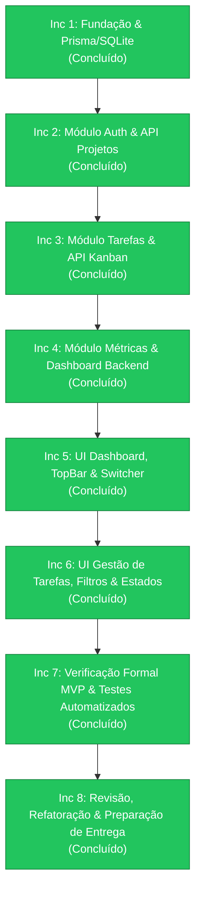

# Plano de Implementação — Plataforma Matriz

* **Projeto:** Matriz — Plataforma de Gestão de Projetos e Acompanhamento de Equipas
* **Contexto:** Ficha Prática 3 — Exercício 1 (Consolidação do Plano de Implementação)
* **Documentos de Referência:** [requirements.md](requirements.md) | [user-stories.md](user-stories.md) | [constraints.md](constraints.md) | [architecture.md](architecture.md) | [database.md](database.md) | [openapi.yaml](../openapi.yaml) | [dashboard-wireframe.md](ui/dashboard-wireframe.md)
* **Versão:** 1.0
* **Data:** 5 de Novembro de 2026
* **Estado:** Aprovado para Execução

---

## 1. Visão Geral e Alinhamento Estratégico

O objetivo deste plano é transformar de forma estruturada, previsível e verificável a documentação aprovada do projeto **Matriz** numa aplicação web funcional. O plano adota a abordagem de **Engenharia de Software Agêntica (*Agentic Software Engineering*)**, decompondo a construção em incrementos pequenos, com dependências claras, critérios de aceitação verificáveis e feedback contínuo (*Human-in-the-Loop*).

---

## 2. Decisões Técnicas: Confirmadas vs. Propostas

### 2.1 Decisões Confirmadas (Aprovadas)
* **Padrão Arquitetural:** Monólito Modular (*Modular Monolith*), com fronteiras estritas entre módulos (`auth`, `projects`, `tasks`, `metrics`).
* **Linguagem & Framework:** **TypeScript** em **Next.js 14+ (App Router)**, unificando frontend e rotas de API num só processo local.
* **Estilização & Componentes:** **Tailwind CSS** + **Lucide React** (ícones).
* **Camada de Dados & ORM:** **Prisma ORM** com **SQLite (`prisma/dev.db`)**, garantindo portabilidade local imediata e zero dependência de containers ou serviços cloud.
* **Validação de Schemas:** **Zod**, garantindo contratos defensivos em runtime para todas as APIs e formulários.
* **Interatividade Kanban:** **`@hello-pangea/dnd`** para arrastar e soltar cartões entre as colunas `TODO`, `IN_PROGRESS` e `DONE`.
* **Gráficos e Analítica:** **Recharts** para o gráfico de barras de velocidade semanal dos últimos 7 dias.
* **Padronização Temporal:** Todos os registos persistidos e cálculos de expiração de prazos usam **ISO 8601 em UTC**, com corte às **23:59:59 UTC** da `due_date`.

### 2.2 Decisões Propostas para a Fase de Código
* **Autenticação no PoC:** *Mock Switcher* interativo na barra de navegação, persistindo o ID do utilizador ativo no `localStorage` e enviando-o via cabeçalho HTTP `X-User-Id` para o backend validar o perfil na base de dados SQLite.
* **Estrutura de Pastas Modular:** Organização em `src/modules/{module-name}/` espelhando a separação de domínio (schemas, services e rotas).

---

## 3. Matriz Consolidada de Regras de Acesso e Permissões (RBAC)

Para resolver qualquer ambiguidade entre os perfis operacionais, estabelece-se a seguinte matriz definitiva:

| Entidade / Ação | Gestor de Projeto (`PROJECT_MANAGER`) | Membro de Equipa (`TEAM_MEMBER`) | Validação & Tratamento de Erro |
|---|:---:|:---:|---|
| **Criar / Editar / Arquivar Projetos** | **Permitido** | **Negado** | Backend retorna `403 Forbidden` se perfil != `PROJECT_MANAGER`. |
| **Criar Novas Tarefas** | **Permitido** | **Permitido (apenas no backlog)** | Criação com `status = TODO`. |
| **Definir ou Alterar Data Limite (`due_date`)** | **Permitido** | **Negado** | Campo bloqueado na UI; API rejeita mutação com `403 Forbidden`. |
| **Atribuir Responsável à Tarefa** | **Permitido (qualquer membro)** | **Permitido (apenas auto-atribuição)** | Membro só pode associar a si próprio tarefas não atribuídas. |
| **Mover Estado no Kanban** | **Permitido** | **Permitido** | Ambos podem transitar tarefas entre `TODO`, `IN_PROGRESS` e `DONE`. |
| **Comentar em Tarefas** | *Fora do Âmbito MVP* | *Fora do Âmbito MVP* | Funcionalidade classificada como *Roadmap Pós-MVP* ([requirements.md](requirements.md)). |
| **Visualizar Dashboard de Métricas** | **Permitido (Visão Global)** | **Permitido (Visão Global ou Própria)** | Membro dispõe do filtro *"Apenas as Minhas Tarefas"*. |
| **Eliminar Projetos ou Tarefas** | **Permitido** | **Negado** | Ação destrutiva exclusiva do Gestor. Tarefas aplicam `ON DELETE SET NULL`. |

---

## 4. Sequência Incremental de Implementação (Roadmap)

---

### Incremento 1: Fundação do Projeto & Base de Dados Relacional
* **Objetivo:** Inicializar o projeto Next.js com TypeScript, Tailwind CSS e estruturar o modelo de dados Prisma com base de dados SQLite local e dados de teste (*seed*).
* **Ficheiros Previstos:**
  * `package.json`, `tsconfig.json`, `tailwind.config.js`
  * `prisma/schema.prisma` (modelos `User`, `Project`, `Task` e enums)
  * `prisma/seed.ts` (1 Gestor, 2 Membros, 2 Projetos e 8 tarefas variadas)
  * `src/lib/prisma.ts` (cliente singleton do Prisma)
* **Dependências:** Nenhuma (incremento inicial).
* **Critérios de Aceitação (BDD):**
  * **Given** a execução do comando de migração do Prisma,
  * **When** a base de dados SQLite for criada,
  * **Then** as tabelas `User`, `Project` e `Task` devem existir com as restrições relacionais (`ON DELETE SET NULL`, `CASCADE`),
  * **And** a execução do seed popula a base de dados com utilizadores e projetos válidos sem erros.
* **Forma de Verificação:**
  * Comando: `npx prisma migrate dev --name init`
  * Comando: `npx prisma db seed`
  * Comando de teste: script de validação de contagem de registos (`node -e "..."`).
* **Estado:** `Concluído` (Migração inicial aplicada, Prisma Client gerado, seed idempotente populado e build Next.js verificado)

---

### Incremento 2: Módulo Auth/Sessão, RBAC e API de Projetos & Utilizadores
* **Objetivo:** Disponibilizar os serviços e endpoints REST para consulta de utilizadores elegíveis, sessão corrente com RBAC e CRUD de projetos.
* **Ficheiros Previstos:**
  * `src/modules/auth/auth.service.ts` e `src/modules/auth/auth.guard.ts`
  * `src/modules/projects/projects.schema.ts` e `src/modules/projects/projects.service.ts`
  * `src/app/api/v1/auth/me/route.ts`
  * `src/app/api/v1/users/route.ts`
  * `src/app/api/v1/projects/route.ts`
  * `src/app/api/v1/projects/[projectId]/route.ts`
* **Dependências:** Incremento 1 concluído.
* **Critérios de Aceitação (BDD):**
  * **Given** o envio do header `X-User-Id` com ID de um Gestor,
  * **When** é enviado um `POST /api/v1/projects` com título válido e datas consistentes,
  * **Then** o endpoint retorna status `201 Created` com o projeto persistido;
  * **Given** o envio do header com ID de um Membro de Equipa,
  * **When** tenta criar um projeto,
  * **Then** a API retorna status `403 Forbidden`.
* **Forma de Verificação:**
  * Teste automatizado com chamadas HTTP (`fetch`) cobrindo `200`, `201`, `400` e `403`.
* **Estado:** `Concluído` (Login, logout, auth/me, users, CRUD completo de projetos com inferência de managerId, pesquisa por título, paginação, confirmação prévia na UI, eliminação em cascata sem dados órfãos e suites de testes validadas)

---

### Incremento 3: Módulo de Tarefas & API do Kanban
* **Objetivo:** Implementar a lógica de negócio e rotas REST para criação de tarefas e transição de estados no Kanban com controlo de concorrência.
* **Ficheiros Previstos:**
  * `src/modules/tasks/tasks.schema.ts` (validação Zod: título 3-100, prioridades `LOW`/`MEDIUM`/`HIGH`, data UTC)
  * `src/modules/tasks/tasks.service.ts` (cálculo em runtime do atributo virtual `isOverdue`)
  * `src/app/api/v1/projects/[projectId]/tasks/route.ts` (GET com filtros e POST de tarefas)
  * `src/app/api/v1/tasks/[taskId]/status/route.ts` (PATCH com suporte a concorrência otimista)
* **Dependências:** Incremento 2 concluído.
* **Critérios de Aceitação (BDD):**
  * **Given** uma requisição `POST /api/v1/projects/{id}/tasks`,
  * **When** a data limite for anterior à data de início do projeto ([EC02](user-stories.md#caso-limite-2-ec02-incoerência-temporal-de-datas)),
  * **Then** o backend rejeita com status `400 Bad Request`;
  * **Given** uma requisição `PATCH /api/v1/tasks/{id}/status`,
  * **When** o estado é transitado para `IN_PROGRESS` ou `DONE`,
  * **Then** a tarefa é atualizada com sucesso e retorna o objeto com `isOverdue` recalculado.
* **Forma de Verificação:**
  * Teste unitário e de integração das rotas de tarefas validando schemas Zod e cálculos de atraso.
* **Estado:** `Concluído` (CRUD completo de tarefas, validação de 3-150 carateres, rejeição de apenas espaços, filtros de estado e prioridade, paginação, alerta isOverdue, múltiplos responsáveis N:M com restrição anti-duplicados, comentários de 1-2000 carateres com autor/data inferidos no backend, modal interativo na UI e persistência total na reabertura de tarefas — suites de 27, 12 e 28 testes validadas)

---

### Incremento 4: Módulo de Métricas & Dashboard Backend
* **Objetivo:** Desenvolver o serviço analítico e o endpoint agregado de métricas do projeto.
* **Ficheiros Previstos:**
  * `src/modules/metrics/metrics.service.ts`
  * `src/app/api/v1/projects/[projectId]/metrics/route.ts`
* **Dependências:** Incremento 3 concluído.
* **Critérios de Aceitação (BDD):**
  * **Given** um projeto sem tarefas ([EC01](user-stories.md#caso-limite-1-ec01-projeto-vazio-sem-tarefas)),
  * **When** o endpoint `GET /api/v1/projects/{id}/metrics` é chamado,
  * **Then** a percentagem retornada é rigorosamente `0.0` (sem divisão por zero);
  * **Given** tarefas com `due_date` anterior às 23:59:59 UTC de hoje e estado != `DONE`,
  * **Then** o contador `overdueTasksCount` reflete a contagem exata e as tarefas constam em `criticalTasks`.
* **Forma de Verificação:**
  * Testes unitários cobrindo a fórmula de progresso, agregação de velocidade de 7 dias e identificação de tarefas atrasadas (`tests/frontend-integration.test.ts`).
* **Estado:** `Concluído` (Endpoint `/api/v1/projects/[projectId]/metrics` com cálculo em tempo real de percentagem com proteção EC01, contagens por estado, tarefas em atraso isOverdue, velocidade semanal e tarefas críticas)

---

### Incremento 5: Interface do Dashboard, TopBar & Mock Switcher
* **Objetivo:** Construir a interface do Dashboard analítico de acordo com o wireframe vetorial aprovado.
* **Ficheiros Previstos:**
  * `src/components/layout/TopBar.tsx` (Navegação pelos 5 ecrãs, Seletor de Projeto e Mock Switcher de utilizadores)
  * `src/components/dashboard/DashboardView.tsx` (Barra de progresso, KPIs por estado, velocidade semanal e tarefas críticas)
  * `src/components/dashboard/WorkspaceView.tsx` (Orquestrador reativo da navegação sem recarregamento de página)
  * `src/app/page.tsx`
* **Dependências:** Incremento 4 concluído.
* **Critérios de Aceitação (BDD):**
  * **Given** a abertura da aplicação no browser,
  * **When** o utilizador seleciona o projeto no dropdown,
  * **Then** todos os cartões, a barra percentual e o gráfico renderizam com os dados da API em tempo real;
  * **And** a alternância de utilizador no Mock Switcher atualiza as permissões visíveis da interface de imediato.
* **Forma de Verificação:**
  * Execução local: `npm run dev` e validação visual responsiva face a `dashboard-wireframe.svg`.
* **Estado:** `Concluído` (TopBar com navegação pelos ecrãs essenciais e Mock Switcher funcional, DashboardView com 4 KPI cards, gráfico de barras dos últimos 7 dias, lista de atenção crítica e tratamento de projeto vazio EC01)

---

### Incremento 6: Interface de Gestão de Tarefas, Filtros & Transição de Estados
* **Objetivo:** Construir a interface completa de gestão de tarefas coerente com o wireframe da Aula 2 e com os requisitos do Exercício 7, integrando listagem, filtros por estado e prioridade, alertas visuais de atraso (`isOverdue`), múltiplos responsáveis e modal de comentários.
* **Ficheiros Implementados:**
  * `src/components/tasks/TaskManagement.tsx` (Listagem, filtros combinados, modais de criação/edição/comentários e atribuição N:M)
  * `src/components/dashboard/WorkspaceView.tsx` (Integração na navegação do espaço de trabalho)
* **Dependências:** Incrementos 1 a 5 concluídos.
* **Critérios de Aceitação (BDD):**
  * **Given** um utilizador a visualizar as tarefas de um projeto,
  * **When** clica para alterar o estado de `TODO` para `IN_PROGRESS` ou `DONE`,
  * **Then** a chamada à API atualiza a base de dados SQLite e sincroniza as contagens do Dashboard e da listagem sem recarregamento da página;
  * **And** a associação de múltiplos responsáveis e a inserção de comentários respeitam o controlo de acessos e a autoria autenticada.
* **Forma de Verificação:**
  * Testes manuais na interface e testes automatizados de integração (`tests/frontend-integration.test.ts`, `tests/task-assignees.test.ts`, `tests/task-comments.test.ts`).
* **Estado:** `Concluído` (Componente `TaskManagement.tsx` implementado com todas as ações ligadas ao backend, filtros por estado/prioridade, alertas visuais de atraso, seleção de utilizadores elegíveis, adição e remoção de múltiplos responsáveis e threads de comentários com ordenação cronológica)

---

### Incremento 7: Verificação Formal do MVP & Testes Automatizados (Ex 8)
* **Objetivo:** Executar testes ponta a ponta, demonstrar que a aplicação cumpre todos os requisitos, trata erros defensivamente e conserva os dados no SQLite.
* **Ficheiros Implementados:**
  * `tests/mvp-verification.test.ts` (Suite formal com 34 asserções cobrindo Casos 01 a 09)
  * `docs/verification.md` (Relatório formal auditável de verificação do MVP)
* **Dependências:** Incrementos 1 a 6 concluídos.
* **Critérios de Aceitação (BDD):**
  * Todas as operações do OpenAPI respondem com os códigos de status documentados;
  * `npm run build` compila sem erros de tipagem TypeScript ou de linting;
  * 3 testes automatizados específicos executados com sucesso: validação defensiva, autorização RBAC e persistência durável pós-reabertura.
* **Forma de Verificação:**
  * Execução dos 7 ficheiros de testes automatizados (151 asserções validadas, 0 falhas).
  * Registo formal das evidências em [`docs/verification.md`](verification.md).
* **Estado:** `Concluído` (151 asserções validadas com sucesso; distinção rigorosa entre testes manuais e automatizados; limitações conhecidas e bugs diagnosticados e corrigidos)

---

### Incremento 8: Revisão, Refatoração, Documentação e Preparação de Entrega (Ex 9)
* **Objetivo:** Rever o diff do repositório, confirmar critérios de aceitação, aplicar oportunidade de refatoração em passo isolado com verificação de não-regressão, sincronizar documentação e contratos, e preparar o repositório para entrega limpa via Git.
* **Ficheiros Afetados:**
  * `src/lib/api-response.ts` (Refatoração: helper padronizado `createErrorResponse`)
  * `src/modules/tasks/tasks.schema.ts` (Refatoração: defensividade de tipagem em `computeIsOverdue`)
  * `AGENTS.md` (Comandos operacionais de execução e verificação)
  * `README.md` (Instruções a partir de cópia limpa, tabela de testes, contas de teste e arranque)
  * `docs/verification.md` (Registo da refatoração e 3 exemplos práticos de uso da IA com sugestão corrigida)
  * `docs/implementation-plan.md` (Atualização final do roadmap e critérios de conclusão)
* **Critérios de Aceitação:**
  * Refatoração não introduz quebras de compatibilidade (151 testes continuam a passar);
  * Instruções do README testadas e reproduzíveis numa cópia limpa;
  * Histórico Git organizado com mensagens claras e semânticas.
* **Estado:** `Concluído`

---

## 5. Critérios de Conclusão da Entrega (Checklist Final)

Todos os critérios de aceitação estipulados no guião da Ficha Prática 3 encontram-se rigorosamente validados:

* [x] **A aplicação arranca seguindo as instruções do README:** Comandos `cp .env.example .env`, `npm install`, `npx prisma migrate dev`, `npm run db:seed` e `npm run dev` / `npm run start` testados e validados.
* [x] **O MVP permite gerir projetos, tarefas, responsáveis e comentários através da interface:** Navegação fluida entre os 5 ecrãs do wireframe com todas as operações ligadas à API e persistidas no SQLite.
* [x] **A autenticação e a autorização funcionam também em pedidos diretos à API:** Sessões HMAC-SHA256 em cookies HTTP-only `matriz_session`, bloqueio 403 Forbidden para ações restritas e inferência estrita de identidade no backend contra identity spoofing.
* [x] **Os dados persistem após recarregar a interface e reiniciar o Backend:** Tarefas, atribuições e comentários mantêm-se íntegros na reabertura de tarefas e após reinicialização do pool Prisma / SQLite.
* [x] **A interface trata carregamento, ausência de dados, sucesso e erro:** Estados de loading com spinners, empty states com mensagens contextuais amigáveis, bloqueio de submissões duplicadas e preservação dos dados de formulário perante falhas.
* [x] **O contrato corresponde à implementação e as verificações têm resultados registados:** As 13 rotas do `openapi.yaml` coincidem com a implementação real; relatório completo e auditável em `docs/verification.md` com 151 asserções com 0 falhas.
* [x] **O código foi revisto e a versão entregue está identificada em Git:** Refatoração aplicada e verificada em isolamento; histórico de commits semânticos organizado via Git.
