# Especificação de Requisitos do Sistema — Matriz

* **Projeto:** Matriz — Plataforma de Gestão de Projetos e Acompanhamento de Equipas
* **Contexto:** Curso de Desenvolvimento de Software com *Agentic Approach* 
* **Versão:** 1.0
* **Data:** 29 de Outubro de 2026
* **Estado:** Aprovado para Desenvolvimento do MVP

---

## 1. Visão e Objetivos da Aplicação

### 1.1 Visão do Produto
A plataforma **Matriz** é uma aplicação web colaborativa concebida para permitir que equipas de desenvolvimento e produtos organizem os seus projetos, façam a gestão transparente de tarefas através de fluxos visuais e acompanhem o progresso do trabalho com métricas objetivas em tempo real.

O sistema foi desenhado de raiz para ser construído, mantido e estendido através de práticas de **Engenharia de Software Agêntica (*Agentic Software Engineering*)**, priorizando modularidade, contratos de dados explícitos e código facilmente testável por modelos de IA e programadores.

### 1.2 Objetivos Principais
1. **Centralização Estruturada:** Eliminar a dispersão de planos de trabalho, agregando o esforço da equipa em Projetos bem definidos.
2. **Visibilidade do Fluxo de Trabalho:** Disponibilizar um Quadro Kanban interativo que reflita instantaneamente o estado das tarefas (*A Fazer*, *Em Progresso*, *Concluído*).
3. **Prevenção Ativa de Atrasos:** Identificar de forma automática e visual tarefas que ultrapassaram a data limite acordada.
4. **Decisão Baseada em Dados:** Apresentar um painel de métricas consolidado com indicadores de taxa de conclusão e velocidade semanal da equipa.
5. **Base Sólida para Iteração com Agentes:** Fornecer contratos de API e modelos relacionais limpos para permitir geração rápida e confiável de código por agentes autónomos.

---

## 2. Tipos de Utilizadores (Perfis e Matriz de Permissões)

A plataforma Matriz suporta dois perfis de utilizador principais no seu MVP:

### 2.1 Perfis de Utilizador

#### 1. Gestor de Projeto (*Project Manager / Tech Lead*)
* **Papel:** Responsável pelo planeamento, coordenação estratégica e monitorização de resultados.
* **Responsabilidades:**
  * Criar, configurar e encerrar projetos.
  * Registar novas tarefas no backlog do projeto, estipular prioridades e datas limite.
  * Atribuir tarefas aos membros da equipa.
  * Analisar o Dashboard de Métricas para avaliar a velocidade e mitigar impedimentos.

#### 2. Membro de Equipa (*Team Member / Developer / Designer*)
* **Papel:** Responsável pela execução prática do trabalho.
* **Responsabilidades:**
  * Consultar a lista de tarefas sob a sua alçada ou do projeto geral.
  * Mover as tarefas ao longo do ciclo de vida no quadro Kanban.
  * Sinalizar conclusões de trabalho para atualizar métricas do projeto.

### 2.2 Matriz de Responsabilidades (CRUD)

| Entidade / Operação | Gestor de Projeto | Membro de Equipa |
|---|:---:|:---:|
| **Criar / Editar / Arquivar Projetos** | Sim | Não (Apenas Leitura) |
| **Criar Novas Tarefas** | Sim | Não (Apenas sugere no backlog) |
| **Editar Metadados da Tarefa (Título, Descrição)** | Sim | Sim (Tarefas atribuídas) |
| **Alterar Data Limite da Tarefa** | Sim | Não (Exclusivo do Gestor) |
| **Atribuir Responsável à Tarefa** | Sim | Sim (Auto-atribuição) |
| **Mover Estado da Tarefa (Kanban)** | Sim | Sim |
| **Consultar Dashboard de Métricas** | Sim (Visão Total) | Sim (Visão de Equipa) |
| **Eliminar Projetos ou Tarefas** | Sim | Não |

---

## 3. Requisitos Funcionais (RF)

Os requisitos funcionais estão agrupados por módulos operacionais:

### Módulo 1: Gestão de Projetos
* **RF01 — Criação e Edição de Projetos:** O sistema deve permitir criar e editar projetos com os campos: *Título* (obrigatório, 3-100 carateres), *Descrição* (opcional, 0-500 carateres), *Data de Início*, *Data Prevista de Conclusão* e *Estado* (`ACTIVE`, `COMPLETED`, `ON_HOLD`).
* **RF02 — Listagem e Filtragem de Projetos:** O sistema deve exibir a listagem de projetos ativos com resumo de progresso percentual e total de tarefas.
* **RF03 — Arquivamento/Encerramento de Projetos:** O sistema deve permitir alterar o estado do projeto para `COMPLETED` ou arquivá-lo, mantendo a integridade do histórico.

### Módulo 2: Gestão de Tarefas
* **RF04 — Criação de Tarefas:** O sistema deve permitir criar tarefas associadas a um projeto com: *Título* (obrigatório, 3-100 carateres), *Descrição* (opcional, 0-2000 carateres), *Prioridade* (`LOW`, `MEDIUM`, `HIGH`), *Data Limite* (*due date*) e *Membro Atribuído*.
* **RF05 — Edição e Atualização de Tarefas:** O utilizador deve poder alterar metadados autorizados da tarefa diretamente na interface, respeitando as permissões do seu perfil.
* **RF06 — Atribuição Flexível:** As tarefas podem ser atribuídas a um utilizador específico ou mantidas como "Não Atribuídas" no backlog.

### Módulo 3: Quadro Kanban
* **RF07 — Visualização em Colunas Kanban:** O sistema deve organizar visualmente as tarefas do projeto em três colunas canónicas:
  * **A Fazer (`TODO`)**
  * **Em Progresso (`IN_PROGRESS`)**
  * **Concluído (`DONE`)**
* **RF08 — Transição Dinâmica de Estados:** O sistema deve permitir mover tarefas entre colunas (via arrastar e soltar ou botões de ação rápida), atualizando de imediato o estado e o timestamp de modificação.
* **RF09 — Filtros Rápidos de Visualização:** O utilizador deve conseguir filtrar o quadro por responsável (ex: "Apenas as minhas tarefas") e por nível de prioridade.

### Módulo 4: Acompanhamento de Progresso e Métricas
* **RF10 — Indicador Global de Progresso:** O sistema deve calcular dinamicamente e exibir a taxa percentual de conclusão do projeto (`(Tarefas DONE / Total Tarefas) * 100`).
* **RF11 — Alerta Visual de Tarefas Atrasadas:** O sistema deve calcular automaticamente se a data limite expirou face à data atual em tarefas não concluídas (`due_date` expirada às 23:59:59 UTC e `status != DONE`), destacando o cartão visualmente e apresentando o número de dias de atraso.
* **RF12 — Gráfico de Velocidade Semanal:** O dashboard deve exibir um gráfico de barras com o histórico de tarefas concluídas por dia nos últimos 7 dias.

---

## 4. Requisitos Não Funcionais (RNF)

Os requisitos não funcionais garantem a qualidade, usabilidade e viabilidade técnica do PoC:

* **RNF01 — Desempenho e Responsividade da UI:** A transição de estado no quadro Kanban e a atualização dos contadores devem responder imediatamente através de atualizações otimistas na interface (< 50ms de latência percecionada), sincronizando com a API em menos de 200ms.
* **RNF02 — Usabilidade e Acessibilidade:** A interface deve ser limpa, responsiva (adaptável a resoluções desktop e tablet) e com contraste visual adequado para leitura de prazos e estados críticos.
* **RNF03 — Confiabilidade e Integridade de Dados:** O sistema deve garantir integridade referencial relacional. Ao eliminar ou desassociar um utilizador, as tarefas associadas não devem ser corrompidas nem gerar falhas na interface (devem passar a *Unassigned*).
* **RNF04 — Arquitetura Orientada a Agentes (Agent-Friendly):** O código deve possuir separação estrita de camadas (Rotas de API, Camada de Serviços/Controladores, Schemas de Validação e Componentes de UI), com tipagem estática (TypeScript ou Python Type Hints) para permitir a rápida iteração por ferramentas agênticas.
* **RNF05 — Portabilidade e Zero-Setup Externo:** O PoC deve ser executável localmente com base de dados relacional incorporada (ex: SQLite), sem dependência inicial de infraestruturas pagas na cloud.

---

## 5. Âmbito do Minimum Viable Product (MVP)

O MVP foca-se estritamente nas funcionalidades que resolvem o problema nuclear: **organizar projetos, gerir tarefas visualmente e acompanhar o progresso**.

```mermaid
flowchart LR
    subgraph IN_MVP ["Dentro do Âmbito do MVP"]
        direction TB
        P1["Gestão de Projetos (CRUD)"]
        T1["Gestão de Tarefas com Prazos e Prioridades"]
        K1["Quadro Kanban Interativo (3 Colunas)"]
        D1["Dashboard com % de Conclusão e Tarefas Atrasadas"]
        M1["Gráfico de Velocidade Semanal"]
        U1["Autenticação Simulada / Troca de Perfis"]
    end

    subgraph OUT_MVP ["Fora do Âmbito Inicial (Backlog Futuro)"]
        direction TB
        F1["Comentários e Discussões nas Tarefas"]
        F2["Sistema de Notificações por Email/Push"]
        F3["Upload e Armazenamento de Anexos"]
        F4["Integrações CI/CD, Slack e GitHub"]
        F5["Múltiplas Organizações (Multi-tenancy)"]
        F6["Exportação de Relatórios em PDF/Excel"]
    end

    IN_MVP -.->|Próximas Fases| OUT_MVP
```

### 5.1 O que ESTÁ Incluído no MVP:
* Registo e listagem de projetos ativos.
* Criação, edição e atribuição de tarefas com data limite e 3 níveis de prioridade (Baixa, Média, Alta).
* Quadro Kanban dinâmico com 3 colunas (`TODO`, `IN_PROGRESS`, `DONE`).
* Alertas de tarefas atrasadas e barra de progresso do projeto.
* Dashboard com gráfico de tarefas concluídas nos últimos 7 dias.
* Troca rápida de utilizador/perfil para validação de fluxos de teste.

### 5.2 Funcionalidades Fora do Âmbito Inicial (Roadmap Pós-MVP):
1. **Comentários e Menções:** Discussão colaborativa dentro de cada tarefa.
2. **Notificações:** Alertas automáticos por email ou notificações push no browser.
3. **Gestão de Anexos:** Upload de ficheiros e imagens pesadas associados a tarefas.
4. **Integrações Externas:** Webhooks para Jira, Trello, GitHub ou Slack.
5. **Multi-tenancy Corporativo:** Isolamento de bases de dados entre empresas clientes distintas.
6. **Métricas Avançadas de Engenharia:** Diagramas cumulativos de fluxo (*CFD*) e gráficos de *Burndown* por sprint formal.
